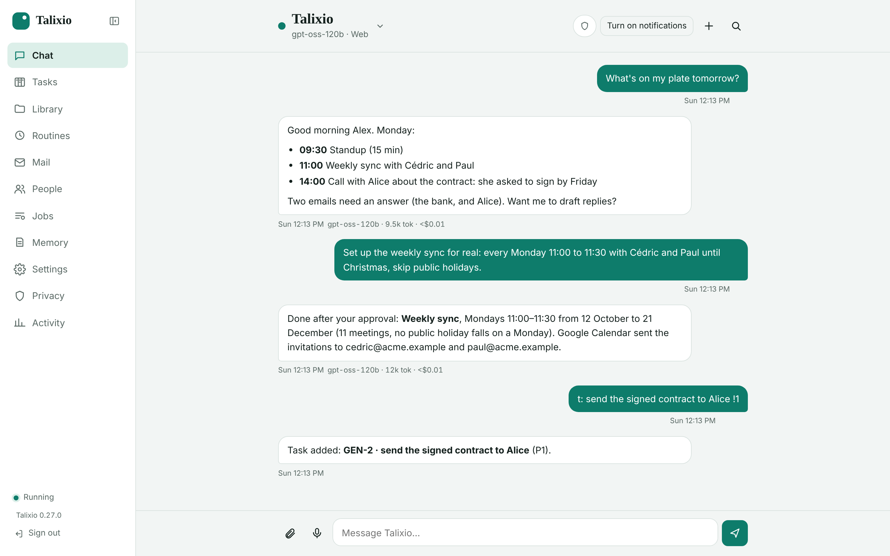
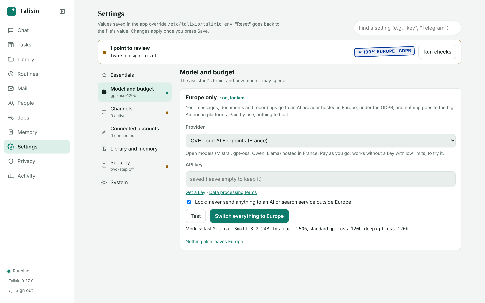
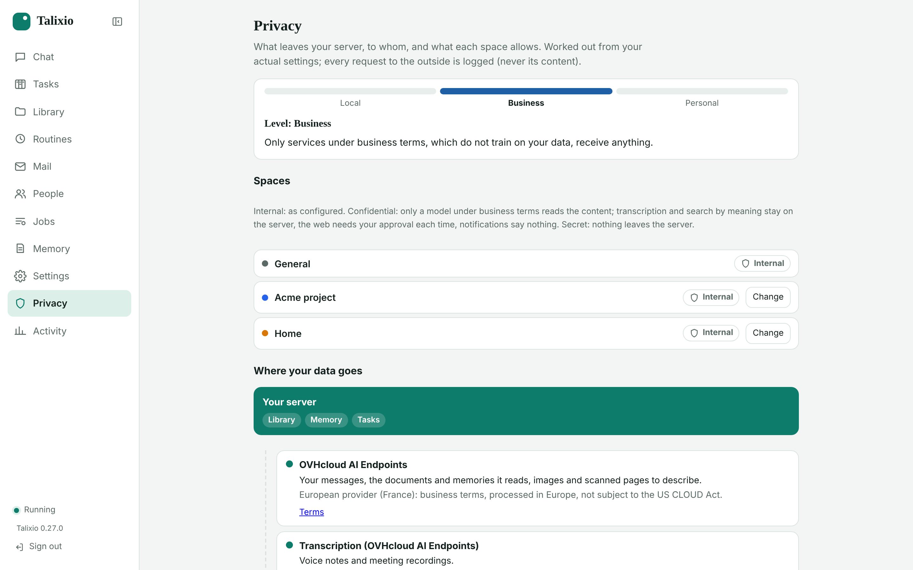
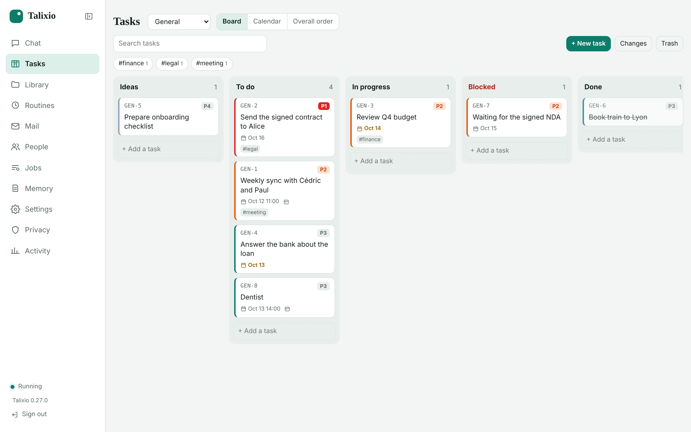
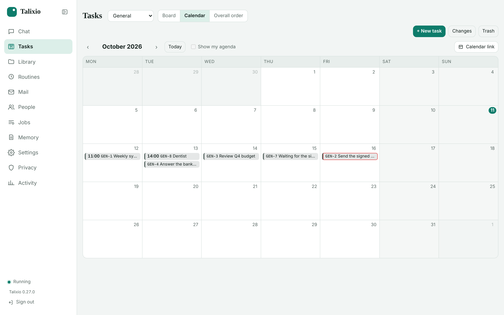
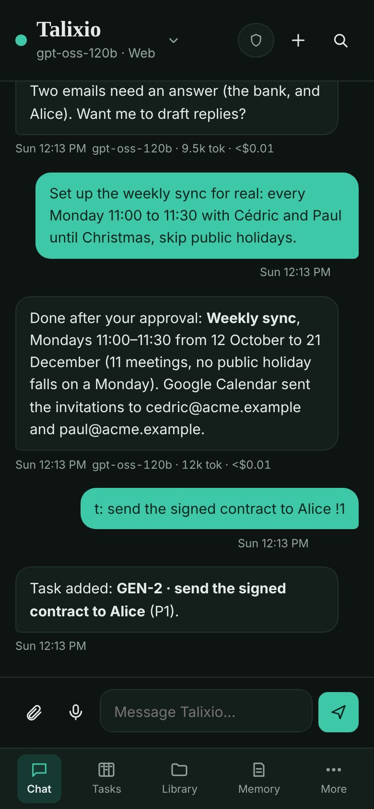

# Talixio AI Assistant

**A personal AI assistant that is European by design and GDPR-friendly: it runs on your own server, and it can
use only AI hosted in Europe.**

It runs 24/7 on your server. You chat with it from a web app (desktop or phone) or Telegram. It remembers you,
keeps your tasks, documents and calendar, searches the web, and can message you first with reminders, briefings
and periodic checks.



## 🇪🇺 European and GDPR-friendly

- **Your data stays on your server.** The conversations, memory, library, tasks and logs are stored on a VM you
  control (in Europe, if you pick a European host), not in someone else's cloud. Back it up, move it to another
  server, or delete it.
- **AI from Europe only.** Use one switch to send everything the assistant sends to an AI (conversation,
  transcription, memory search) to one provider hosted in Europe, under the GDPR and outside the US CLOUD Act:
  **OVHcloud** (France), **Mistral AI** (France), **Scaleway** (Paris) or **Infomaniak** (Switzerland). You pay
  by use and have nothing to host. You can also run a local model (Ollama), so nothing leaves the server at all.
- **Locked, not just a preference.** `TALIXIO_SOVEREIGN_ONLY=1` turns off whatever has no European option, and
  the settings list what would still leave Europe and where to change it. The check runs where requests leave
  the server, not in the model's good will.
- **Every outside request is logged.** The log records the service, purpose, size and space, but never the
  content. It can be exported as CSV, and a GDPR record of processing can be downloaded to start from.
- **A confidentiality level per space.** *Internal*, *Confidential* (only business-terms models, approval
  before going on the web, content-free notifications) or *Secret* (nothing leaves the server).
- **Self-hosted, public source.** You can read what it does. You need no account with us, and it sends no telemetry.

| Europe only, locked | Where your data goes |
|---|---|
|  |  |

Claude, OpenAI and Gemini are still available if you choose them (API key, or your Claude Pro/Max subscription
through Claude Code). The Privacy page then shows exactly what goes to them.

## A look around

| Tasks: a board per space | Calendar: tasks with times, next to your agenda |
|---|---|
|  |  |

<p align="center"></p>

It works with Google, Outlook or any CalDAV calendar, including recurring meetings with guests and public
holidays left out. It handles mail (IMAP and SMTP), Signal and Telegram, voice notes and meeting summaries, a
searchable library with citations, routines, and connectors (MCP). You can install it as an app on your computer
and phone. The full list is under [What it can do](#what-it-can-do).

See [docs/what-an-assistant-is-2026.md](docs/what-an-assistant-is-2026.md) for the target definition
and roadmap.

## Install on a VM (Debian 12+ / Ubuntu 24.04+)

```bash
git clone https://github.com/fredolier/talixio-ai-assistant.git
cd talixio-ai-assistant
sudo ./install.sh
```

It installs PHP, creates a `talixio` system user, copies the app to `/opt/talixio`, writes
`/etc/talixio/talixio.env` with a random web password, and starts two services:
`talixio-worker` (Telegram, schedules, heartbeat) and `talixio-web` (the web app on
`127.0.0.1:8080`). It starts in **echo mode** (no model) so you can check the install first.

Options:
- `sudo ./install.sh --domain assistant.example.com` installs Caddy **on this VM** for HTTPS. Point the
  DNS at the VM and open ports 80 and 443 first.
- `sudo ./install.sh --bind 10.0.0.5:8080` when your reverse proxy runs **on another machine**: the
  app listens on the VM's private address, and you add to your Caddyfile:
  ```
  assistant.example.com {
      reverse_proxy 10.0.0.5:8080
  }
  ```
  Allow port 8080 only from the proxy (`ufw allow from <proxy-ip> to any port 8080`).
- HTTPS (either way) is needed to add the web app to your phone's home screen.
- `sudo ./install.sh --with-claude-code` installs the Claude Code CLI for the `talixio` user.
- `sudo ./install.sh --with-ollama` installs [Ollama](https://ollama.com) (official script, systemd
  service listening on 127.0.0.1 only) and the local embedding model **qwen3-embedding:0.6b**, and
  uses it for memory search: free, private, works in French. `--with-ollama=docker` runs Ollama in
  a Docker container instead. Another model: `OLLAMA_EMBED_MODEL=embeddinggemma sudo ./install.sh --with-ollama`.
  Needs about 1 GB of RAM while indexing.

**Updates:** in the app, **Settings → Updates** shows new versions from the repository (checked
every 6 hours), with **Update now** (backup, `git pull`, reinstall, restart) and **Restore previous
version**. You get a notification when a new version is available; turn on automatic night-time
updates in Settings if you prefer. By hand it's still `git pull && sudo ./install.sh` (your config
and data are kept). The update runs as root through a small systemd service
(`talixio-update.path/.service/.timer`); the web app only drops a request file. It runs git as the
clone's owner, so a private repository works with your own git credentials. If your clone has local
changes, the update stops and tells you.

### Open the web app
- With `--domain` or your own proxy: `https://assistant.example.com`
- Without: tunnel from your computer, `ssh -L 8080:127.0.0.1:8080 you@your-vm`, then open
  http://localhost:8080

### Settings
Everything is configurable in the app: **Settings** (AI model, keys, budget, notifications, email,
your mailbox, calendar, Signal, Telegram, search, audio, browser, approvals, backups, password).
Values saved there are kept in `/var/lib/talixio/settings.json` and override
`/etc/talixio/talixio.env`; "reset" returns to the file's value. Secrets are never shown back.
The version you run is at the bottom of the menu, in Settings → *Updates* and with
`talixio version`; what each version brought is in `CHANGELOG.md`.

**Run checks** tests the logins and makes one call per model tier (same as `sudo talixio doctor`).

The interface is in English and French (Settings → Assistant → *Interface language*; automatic =
your browser's language). The assistant answers in the language you write in. Translations are in
`web/public/i18n/<lang>.js` (English text → translation); `web/public/i18n.js` applies them to
everything the app shows. Another language: a dictionary file, its `<script>` in `app.html`, and its code in `I18n::LANGS`.

### Choose the brain

The simplest with a Claude Pro/Max plan: Settings → AI model → **Sign in with Claude** (also offered in the
conversation while no model is set up). It runs Claude Code's own sign-in from the web app: open Claude's
page, paste the code back. Needs Claude Code on the server (`--with-claude-code`; in the Docker image).

| Option | Settings |
|---|---|
| Gemini API | `TALIXIO_PROVIDER=gemini`, `GEMINI_API_KEY=...` (create one at https://aistudio.google.com/apikey) |
| Claude API | `TALIXIO_PROVIDER=anthropic`, `ANTHROPIC_API_KEY=...` |
| Claude Pro/Max subscription | `./install.sh --with-claude-code`, then `sudo -u talixio HOME=/var/lib/talixio /var/lib/talixio/.local/bin/claude setup-token`, put the token in `CLAUDE_CODE_OAUTH_TOKEN=` and set `TALIXIO_PROVIDER=claude-code` |
| OpenAI | `TALIXIO_PROVIDER=openai`, `OPENAI_API_KEY=...` |
| Local model (Ollama...) | `TALIXIO_PROVIDER=openai`, `OPENAI_BASE_URL=http://localhost:11434/v1`, `TALIXIO_MODEL=llama3.1` |
| European provider (OVHcloud, Mistral, Scaleway, Infomaniak) | `TALIXIO_PROVIDER=sovereign`, `TALIXIO_SOVEREIGN=ovhcloud`, `TALIXIO_SOVEREIGN_KEY=...` (or Settings → Model and budget → **Europe only**) |

With Gemini, the tier models are picked automatically from the models your key can use (newest
Flash-Lite / Flash / Pro, checked daily); `sudo talixio doctor` shows which. Web search uses Google
Search grounding and memory search uses Gemini embeddings, with the same key. A Google AI Pro/Ultra
subscription does not include API access; the API key is separate. On the free tier, Google may use
your prompts to improve its products and rate limits are low; enable billing on the key to avoid both.

With the Claude subscription option, usage counts against your plan's limits. Anthropic's policy on this
has changed several times in 2026; see
[Use the Claude Agent SDK with your Claude plan](https://support.claude.com/en/articles/15036540-use-the-claude-agent-sdk-with-your-claude-plan).

**Europe only.** Settings → Model and budget → *Europe only* switches everything the assistant sends to an AI
(conversation, transcription, memory search) to one provider hosted in Europe, under the GDPR, paid by use with
nothing to host: OVHcloud AI Endpoints (France; open models including Mistral's, works without a key with low
limits to try it), Mistral AI (France; on the free Experiment plan Mistral may train on your data), Scaleway
(Paris) or Infomaniak (Switzerland). *Test* checks the key and shows the models picked for each tier, with their price per million tokens and
what a typical message and a month of use cost. The lock
(`TALIXIO_SOVEREIGN_ONLY=1`) turns off what has no European option (web search other than your own SearXNG,
online embeddings or transcription elsewhere), and the card lists what still leaves Europe (Telegram, Google
Calendar, Spotify, remote connectors) with where to change it. On a multi-user server, the admin page can give
every assistant one European account (Settings → *AI in Europe for everyone*). Check each provider's data
processing agreement for your own use.

### Security
The web app is password protected (`TALIXIO_WEB_PASSWORD`, generated at install; sessions last 30
days). At the first sign-in the password is replaced by a hash in `data/settings.json` (the one in
`talixio.env` is then ignored and can be removed). After 5 wrong passwords in 15 minutes (or 20 in a
day) an address is blocked for a while and you get a notification; behind a reverse proxy on a private
address, the client address comes from `X-Forwarded-For`. **Two-step sign-in** (Settings → *Two-step
sign-in*) adds a 6-digit code from an authenticator app. Changing the password signs out other devices.
Forgot the password: `sudo talixio password`. Lost the phone: `sudo talixio totp off`.
Shares from other apps (Android share sheet) arriving without a session are limited to 25 MB and
10 per hour. Chat channels only answer allowlisted senders.
If your reverse proxy is on another machine, the hop between it and the VM is plain HTTP: bind to
the VM's private IP (or `0.0.0.0:8080`) and firewall port 8080 to the proxy only.

### Install the app (computer and phone)
Talixio is an installable web app (PWA): its own window and icon, opens instantly (also offline),
notifications, a badge for pending approvals, and shortcuts (New message, Record a meeting, Tasks).
- **Chrome / Edge (Windows, Mac, Linux)**: the install icon in the address bar, or Settings → *Install the app*.
- **Android (Chrome)**: menu ⋮ → *Install app*. Then **Share → Talixio** from any app sends photos,
  PDFs, voice notes, links or text to the assistant (they wait in the message box until you press Send).
- **iPhone / iPad (Safari)**: Share → *Add to Home Screen* (iOS has no "share to" for web apps).
- **Mac (Safari)**: File → *Add to Dock*.
HTTPS is required (your domain behind Caddy). When a new version is installed on the server, open
apps show "A new version is ready – Reload".

### Push notifications from the web app
Open the app over HTTPS, go to **Channels** and press **Turn on for this device** (on iPhone/iPad:
first Share → Add to Home Screen, then open it from there). Reminders, briefings and job results
then arrive as notifications, like a native app. Works per device; no extra service needed.
**ntfy** is an alternative: set `TALIXIO_NTFY_URL=https://ntfy.sh/<long-random-topic>`.

### Email
Give the assistant its own mailbox (e.g. `assistant@yourdomain`), then set in the config:
```
TALIXIO_SMTP_HOST=smtp.yourprovider.com    # Gmail: smtp.gmail.com with an app password
TALIXIO_SMTP_PORT=587
TALIXIO_SMTP_USER=assistant@yourdomain
TALIXIO_SMTP_PASSWORD=...
TALIXIO_EMAIL_FROM=Talixio <assistant@yourdomain>
TALIXIO_EMAIL_TO=you@yourdomain            # notifications go here
TALIXIO_IMAP_HOST=imap.yourprovider.com    # optional: to chat by email
```
- **Notifications** need only SMTP and `TALIXIO_EMAIL_TO`.
- **Chat by email**: with IMAP set, it checks the mailbox every minute and answers emails from
  `TALIXIO_EMAIL_ALLOWED` (default: your address) in the same thread as the web app. It only trusts
  mail your provider verified (SPF/DKIM/DMARC in `Authentication-Results`), so forged senders are
  ignored; set `TALIXIO_EMAIL_REQUIRE_AUTH=0` only if your provider doesn't add that header.
- Microsoft 365 mostly disables password login for SMTP/IMAP; it would need OAuth (not supported yet).
- `sudo talixio doctor` tests the SMTP and IMAP logins.

### Signal
Needs a phone number dedicated to the assistant (a cheap prepaid SIM or eSIM that can receive one SMS).
```bash
sudo ./install.sh --with-signal                  # installs signal-cli (native build, x86_64)
sudo nano /etc/talixio/talixio.env               # TALIXIO_SIGNAL_NUMBER=+33..., TALIXIO_SIGNAL_ALLOWED=<your number>
sudo talixio signal register                     # if asked for a captcha: open https://signalcaptchas.org/registration/generate.html,
                                                 # solve it, copy the signalcaptcha:// link, then:
sudo talixio signal register --captcha 'signalcaptcha://...'
sudo talixio signal verify 123456                # the code received by SMS
sudo talixio signal updateProfile --given-name Talixio
sudo systemctl restart talixio-worker
```
Then message the assistant's number from your Signal app.

### Telegram (optional)
Create a bot with @BotFather, set `TALIXIO_TELEGRAM_TOKEN`, restart, and message the bot. It replies
with your chat id; put it in `TALIXIO_TELEGRAM_ALLOWED_IDS`. Telegram and the web app share the same
conversation.

## Several people on one server (Docker)

One assistant per person, each with their own data, keys (and costs) and password, managed from an
admin page (`https://<domain>/admin/`) without SSH; a shared Ollama for memory search. An existing
installation can be moved into it. See [deploy/docker/README.md](deploy/docker/README.md):

```bash
sudo deploy/docker/install-stack.sh --domain assistant.example.com --email you@example.com [--migrate fred]
```

## Moving an assistant to another server

Settings → **Move to another server** → *Create a transfer code* (valid a day). On the new server: admin
page → People → **From another server** (Docker), or `sudo talixio transfer-pull <old address> <code> [--final] --url <new address>`.
Everything comes: conversations, memory, skills, library, tasks, settings and keys, password, two-step
sign-in, Signal registration. A test copy arrives paused (no channels, no routines, so the two never
answer the same messages) and can be repeated; the final one (`--final`) is active and pauses the old
server, which then shows the new address. What the destination held before is kept in `.previous-<date>`.

## FAQ in the library

`/FAQ` (read-only) holds the notes about Talixio, in French (`/FAQ/Français`) and English (`/FAQ/English`):
using it, privacy, installing and updating, administration, connectors. It also has one page per version from
the changelog (`/FAQ/English/What's new`) and this README (`/FAQ/English/Reference`). Pages come from
`docs/faq/<language>/` and are brought up to date when a new version starts. They are indexed, so the assistant
answers questions about itself from them, in your language.

## Privacy (what leaves the server)

The **Privacy** page (menu) is worked out from your settings: each service your data can go to, what it
receives, whether it may train on it (business API terms, free tiers, personal subscriptions), and a fix
when there is one. Every request to the outside is logged (service, purpose, size, space: never the
content), exportable as CSV, and a record of processing (GDPR) can be downloaded to start from.

Each space has a confidentiality level (shield next to its name):
- **Internal**: as configured.
- **Confidential**: only a model under business terms (Claude API, OpenAI API, Gemini with
  `TALIXIO_GEMINI_PAID=1`) reads the content. Transcription and search by meaning must run on the
  server (whisper.cpp, Ollama) or are skipped, web search, web pages, the browser and connectors wait for
  your approval each time, notifications say nothing, shared links need a password and end within 30
  days, and the space can't be used from Telegram.
- **Secret**: nothing leaves the server; the assistant answers there only with a model on the server.
  Its conversations and documents are not searched from other spaces, and nothing is shared.

These are enforced where requests leave (every outside call goes through one check), not by the model's
good will: a General question that reads a confidential document becomes confidential from then on.
Under each answer, pills show where it went (and tapping them, which documents were given to the model,
what stayed on the server and what was blocked). `TALIXIO_NOTIFY_NEUTRAL=1` makes every notification
content-free.

## What it can do
- **Live answers**: replies appear as they are written, with what it's doing ("Searching the web…",
  "Reading example.com…"). The send button becomes **Stop** while it writes (what was written is kept).
  Copy any message; **edit** your last message or ask for a **new answer**. **Find in the
  conversation** (magnifier at the top) jumps to old messages. The message you are writing survives
  closing the app, and a message sent while offline goes out as soon as the connection is back.
- **Filing the Inbox**: for each new document the app suggests a folder and a clear name
  ("scan_0012.pdf → /Admin/Factures/Facture EDF 2026-10.pdf"); *File it*, *Change…* or *File them
  all*. The folder is decided in embedding space from the documents you already filed (no model
  call, and it learns from every move you make); the fast model is only asked when that is unclear or
  the name is meaningless. Settings → *Filing new documents*: suggest, file the obvious ones, or off.
- **Mail to handle** (needs your mailbox): every 15 minutes new emails are sorted into *to answer*,
  *to do* (with due dates), *to read* and *low priority*: newsletters by their headers, the others
  in embedding space from earlier decisions, the fast model only when unsure (several emails per call).
  Move an email to another group and it learns. *Prepare a reply* asks the assistant for a draft.
- **People**: everyone you hear from by email becomes a contact; the assistant adds what it learns
  (`contact_save`). A person's page shows notes, recent emails, documents and conversations mentioning them.
- **Morning briefing** (Routines page): at the time and days you choose: today's calendar, emails to
  handle, reminders and deadlines, the weather. *Send it now* to try it; every task has *Run now*.
- **Tasks** (a board per space, like Trello): columns Ideas / To do / In progress / Blocked / Done,
  codes per space (MAI-12; set the prefix in the space settings), priority P1 (most urgent) to P5,
  start and due dates, workload ("3h", "2d" of 7h) and time spent (logged per day, for planning and
  a future Gantt chart), tags, a description edited like a document (stored as Markdown; checklists
  count as progress) and dependencies, also across spaces (loops refused; a task due before what it
  waits for is flagged). Drag cards between columns; on a phone, swipe between columns. Each space's
  assistant manages its own tasks and only sees the title and status of other spaces' tasks; General
  sees them all and keeps an **overall order** across spaces (ask it to propose one). Deleted tasks
  stay in a trash for 30 days, every change is logged with who made it and can be undone, and an
  edit made in two places at once is refused instead of overwriting.
  A **calendar** view shows tasks on their due date (drag one to another day; on a phone, a list of
  days), with your agenda's events if you want. Tasks marked "show in my calendar" go to Google
  Calendar (all-day, start to due date, kept up to date) or to any calendar app through a private
  iCal link; the others stay private. A notification the evening before lists what is due tomorrow
  (Settings → Tasks), the morning briefing lists overdue and coming tasks, an email on the Mail
  page becomes a task in one click, and meeting summaries offer their action items as tasks.
- **Spaces**: separate conversations for separate subjects (a client, the house, health…), switched
  from the top of the chat. Each has its library folder (searched first; attachments are filed
  there), its instructions, its notes kept by the assistant, a default model and a colour. A space
  doesn't see the others' conversations unless you ask. Telegram/Signal/email write to General;
  `/space Maison` switches them. Settings → *Appearance*: light, dark or automatic, and an accent colour.
- **Library (your knowledge base)**: every file is kept in folders you organise (`/Clients/Alice`,
  `/Admin/Taxes`...), browsable in the **Library** page (folder tree, breadcrumb, preview, drag and
  drop to upload or move, rename, delete, Markdown notes you can view and edit). Every file can
  be downloaded, or viewed in the app: photos, PDFs page by page (works on phones too), audio and
  video with seeking; Markdown notes and .md files rendered (tables, task lists...), saved web pages
  shown as they look (scripts off), Word/Excel/PowerPoint/OpenDocument converted to a readable page
  with their images, CSV as a table, emails with their headers. "Open in a new tab" shows the same
  rendered page. A whole folder downloads as a ZIP keeping its subfolders. Chat and Signal/Telegram
  attachments land in `/Inbox`, recordings in `/Meetings`. In the background each file is read and
  indexed for search: PDF (scanned pages are transcribed by the fast model), Word/Excel/PowerPoint
  and OpenDocument, HTML, emails (.eml), Markdown/CSV/text, audio (transcribed) and photos
  (described, text in them transcribed: receipts, whiteboards). Search the whole library or one
  folder, from the page or by asking: the assistant has `kb_search`, `kb_list`, `kb_save_note`
  and `kb_move`, cites files by path, and can file attachments for you ("put this invoice in
  Clients/Alice"). "Ask about this" on a file opens the chat with it attached. Reading images and
  scans costs a little per image/page (fast tier, counted under "indexing" on the Activity page);
  turn it off with `TALIXIO_VISION_INDEX=0`.
- **Photos, PDFs, documents in the chat**: attach (or paste, or drag) files in the web app, or send
  them on Telegram/Signal. Images are shown to the model; documents are read.
- **Voice notes**: tap the microphone in the web app, or send a voice message on Telegram/Signal:
  it's transcribed and answered.
- **Meeting summaries**: record a meeting in the web app (microphone → "Summarise meeting"; keep
  the page open and the phone awake) or upload a recording (any audio over 3 minutes counts as a
  meeting). It's transcribed with speaker labels in the background, then you get a summary,
  decisions, action items (who/what/when) and open questions, and it offers reminders for your
  action items. Transcripts and summaries are searchable later. Transcription uses Gemini
  (`GEMINI_API_KEY`, also works when Claude is the brain; about $0.15 per hour of recording with
  Flash), OpenAI, or runs on your server with whisper.cpp (`sudo ./install.sh --with-whisper`, then
  Settings → Audio → Transcription → Local): the audio never leaves the server, it's free, but
  slower (roughly half the recording's length on 4 cores) and without speaker names. Claude itself
  does not take audio input, hence the separate step. Telegram bots can only
  receive files up to 20 MB, so upload long recordings in the web app.
- **Learning (skills)**: procedures it has learned for you, as Markdown files (`workspace/skills/`),
  listed in its instructions and read when a task matches. After a multi-step task, a small
  background job decides whether it's worth keeping and tells you when it learns or updates one.
  See, edit or delete them on the Memory page.
- **Nightly backups** of the database, memory, skills, files and keys (last 7 kept). Run one now
  with `sudo talixio backup`. Restore: stop the services, extract the archive into
  `/var/lib/talixio`, rename `backup-snapshot.db` to `talixio.db`, `chown -R talixio:talixio`, start.
- **Headless browser** (`install.sh --with-browser`): opens pages with JavaScript, clicks, types,
  chooses options and takes screenshots it can look at. Every request the browser makes is checked:
  local/private network addresses are refused. Submitting a form that sends data (login, order,
  contact...) pauses until you approve (passwords are masked in the request). Cookies are kept
  between runs in `/var/lib/talixio/browser-profile`.
- **Viewer**: PDFs are shown as page images (every device) and open in the browser's PDF viewer;
  Markdown, HTML, emails, CSV, JSON and Office files have a readable view; photos, audio and video
  play natively. With **LibreOffice** (`install.sh --with-office`) Word, Excel and PowerPoint files are
  shown as their real pages (and open as PDF), and older `.doc`, `.xls`, `.ppt`, `.rtf` are read and
  searchable too. *Ask about this folder* in the library starts a question on those documents. Answers cite
  documents with their page ("Bail Dupont p. 3"): a click opens the viewer at that page.
- **Sandboxed shell** (`install.sh --with-shell`, then Settings → *Sandboxed shell*): the assistant gets
  a Linux sandbox of its own (bubblewrap) with Python (numpy, pandas, matplotlib) for exact
  calculations, data analysis, file conversions and charts; it saves results to your library. It sees
  only the system programs and its work folder (`data/sandbox/work`), never your server, data or
  keys; no internet unless you allow it; time and memory limits. Mode *ask me* shows every command
  and waits for your approval.
- **Connectors (MCP)**: Settings → *Connectors* takes the usual `mcpServers` JSON: local servers
  started by command (`install.sh --with-node` for `npx` servers) or remote ones by URL (token in
  `headers`, or **Sign in** for services that use OAuth: Notion `https://mcp.notion.com/mcp`,
  Linear, Atlassian...; Talixio registers itself, you accept on their page and come back; tokens
  are kept in `data/mcp-oauth.json` and renewed. A service without automatic registration needs
  `"oauth": {"client_id": "…", "client_secret": "…"}` and the redirect URI
  `<your address>/api/mcp/oauth/callback`). Their tools join the assistant's; tools not marked read-only wait for your approval
  unless the server has `"trust": "all"`. Background jobs only get the read-only ones.
- **Approvals**: anything with outside effects (sending email as you, adding calendar events)
  waits for you: Approve/Reject buttons in the app, or reply "yes 12" / "no 12" on Signal,
  Telegram or email. Requests expire after 7 days. `TALIXIO_AUTO_APPROVE` skips the question for
  tools you trust.
- **Google Calendar** (Settings → *Google Calendar*, steps shown there): with your own OAuth client
  it reads every calendar you show in Google Calendar and adds events to your main one after your
  approval. Publish the OAuth app "In production" (testing apps lose access after 7 days).
- **Spotify** (Settings → *Spotify*, steps shown there; Premium needed): "play Daft Punk", "my
  running playlist", "pause", "louder", "add this to my playlist": the music plays on your phone
  or speaker, from the app, Telegram or anywhere. With your own app from developer.spotify.com.
  When no device is available (Spotify closed), the answer has a button that opens Spotify on it.
- **Phone buttons**: a web app can't open other apps by itself, so the assistant puts buttons in its
  answers that you tap: open an app, navigate (Maps, Waze), call, text, WhatsApp, email, YouTube.
- **Your calendar**: reads any iCal subscription link (Google, Outlook, iCloud...) and/or a CalDAV
  calendar; adds events through CalDAV after approval. Recurring events are expanded.
- **Your mailbox**: lists and reads your email without marking it read, writes drafts into your
  Drafts folder, and sends as you only after approval (with a copy in Sent).
- **One conversation everywhere**: web app, email, Signal, Telegram and terminal (`sudo talixio chat`)
  share one thread. Messages it starts go to push notifications, email, Signal, Telegram or ntfy
  (`TALIXIO_NOTIFY`); see and test them on the **Channels** page.
- **Memory you can edit**: `USER.md` (about you), `MEMORY.md` (notes), `SOUL.md` (personality),
  `HEARTBEAT.md` (checklist), editable on the Memory page.
- **Reminders and recurring tasks by chat** (each with its model tier, changeable on the Routines page; a finished job can be run again on another tier): "remind me tomorrow at 9", "every weekday at 8:00 send
  me a briefing". Visible and pausable on the Routines page.
- **Heartbeat** (off by default): every N minutes it reads `HEARTBEAT.md` and only messages you if
  something needs attention. Each check is a model call, so it costs tokens.
  Every check is listed on the Activity page (what it looked at, why it stayed quiet), with *Check now*.
- **Web search** (Claude's built-in search, or Brave / Tavily / SearXNG) and **page reading** that
  blocks internal network addresses.
- **Searchable history (RAG in SQLite)**: messages, summaries, documents and transcripts are indexed
  with FTS5 keyword search, and with an embeddings model for search by meaning (hybrid ranking).
  Long documents are split into overlapping chunks so the right passage is found. Recommended
  local model: `qwen3-embedding:0.6b` through Ollama (best multilingual score among small models,
  Apache 2.0, 32k context), vectors kept at 512 dimensions for speed. Changing the model re-indexes
  memory in the background. Gemini, OpenAI and Voyage embeddings work too. Settings → Web search and
  memory offers the choices side by side, lighter local models included (EmbeddingGemma,
  multilingual-e5-small) for modest servers, with *Measure on this server*. With sqlite-vec (in the
  Docker image; `install.sh` adds it) SQLite compares the vectors, about 6 times faster than PHP. Relevant past snippets are
  added to the prompt automatically, and the assistant can call `search_memory`. You can search too,
  on the Memory page.
- **Compaction with progressive forgetting**: the latest messages are sent word for word, within a
  size limit (`TALIXIO_HISTORY_TOKENS`, long pasted texts shortened). Older ones are summarised in
  stretches; once a week is over its summaries are merged into one shorter week summary, and a past
  month's weeks into an even shorter month summary. The assistant reads this digest before every
  answer (Memory page → *Conversation digest*), so it keeps the thread of months of conversation for
  a fixed cost, while details fade. Nothing is deleted: every message and summary stays searchable.
- **Sharing documents with people outside**: Library → *Share* on a document or a folder makes a
  link (`/s/<random>`): for whom, a message, until when (1, 7, 30, 90 days or no end), an optional
  password, view only or download. The page needs no account, is in the visitor's language and is
  not indexed by search engines; a folder link shows its subfolders as they are when opened and can
  be downloaded as a zip. *Shares* lists every link: copy, email, extend by 30 days, revoke, and who
  opened what and when; you are told when a link is opened the first time. Links follow a folder
  when it is moved; ended links are forgotten after 90 days. The assistant can share too
  (`share_create`, after your approval). Set Settings → Assistant → *Public address* if the links
  must use another address than the one you open the app with.
- **Character and values, learned by itself** (`TALIXIO_MIND`): each compacted stretch of
  conversation is read again for what it shows beyond facts: what matters to you (values), how you
  decide and work (patterns), and how it should be (lessons about itself); the assistant also notes
  strong signals as they happen. Once a day it folds these observations into beliefs, each with its
  evidence and a confidence that grows when confirmed on several days, drops when contradicted and
  fades when nothing confirms it (half-life 4 months). Once a week it rewrites its self-portrait in
  the first person, from `SOUL.md` (the seed), what it learned and the previous portrait, and keeps a
  journal of what changed. Established beliefs and the portrait go into every answer (values also
  into jobs) and weigh in its choices; it says when one shapes a decision, your explicit
  instructions always win, and it keeps the right to disagree. It also learns from the history that
  came before (compacted summaries, as hints). Memory page → *Character and values*: the portrait,
  each belief with *Why?* (its evidence) and *Forget* (for good: it won't learn it again), the
  emerging ones, the journal. Never about health, religion, politics, sexuality or origin. Cost: a
  fast-model call per compacted stretch, a standard one per day and per week.
- **Model tiers**: fast (heartbeat, summaries, simple lookups), standard (chat), deep (hard reasoning,
  with extended thinking on Claude). Each space has its own default tier, General included (from the
  space menu); start a message with `/deep` or `/fast` to choose for one message. Each reply
  shows the model, tokens and estimated cost.
- **Fewer tool tokens**: with the European and OpenAI-compatible providers, a message gets only the tools it
  seems to need (memory, files and web always; mail, calendar, tasks… when the conversation mentions them),
  and the model can ask for the others. `TALIXIO_TOOLS=all` sends them all, `focused` always focuses.
- **Budget**: daily and monthly limits in USD. Over 80% it switches to the fast tier and stops
  starting sub-agents; at 100% it stops calling models. The assistant sees its spending and has a
  `usage_report` tool.
- **Sub-agents**: for research and multi-step work the assistant starts background jobs (`delegate`),
  up to 3 in parallel, each with its own tier and a cost cap ($2 by default; say "budget 5 $" for a bigger one, up to `TALIXIO_JOB_MAX_USD_LIMIT`) and an effort level (low to max: deeper thinking and more steps, `TALIXIO_JOB_EFFORT`). Near its cap a job is told to write its report; one stopped by its cap can carry on from where it stopped ("continue job 12 with 3 $", or *Continue* in Jobs). It replies right
  away; the report arrives in the chat of the space that started it, and as a notification that
  names the space and opens it. Sub-agents can search and read but cannot change memory, schedules
  or start more jobs. The Jobs page shows each job's space and tags (the assistant tags them, you
  can edit them), filters by space or tag, and shows reports with tables, lists and headings.
- **Prompt caching** on Claude: the stable part of the instructions is cached (re-reads cost 10%).
- **Activity page**: spending against your budget, cost by tier and by source, tokens per day, and
  an audit log of every tool call.

Costs are estimates from list prices built into `src/Pricing.php` (Claude: Haiku $1/$5, Sonnet
$3/$15, Opus $5/$25 per million tokens). Check your provider's pricing and override with
`TALIXIO_PRICES` if they differ.

Not yet: Microsoft 365 mail (needs OAuth), WhatsApp, Slack, Teams, spoken replies, starting apps
on the phone without a tap (would need a native Android app).

## Files
```
install.sh                 install / update
config/talixio.env.example all settings, documented
deploy/                    systemd units, `talixio` CLI wrapper
src/                       PHP app (no dependencies beyond php-curl, php-sqlite3, php-mbstring)
web/                       web app (router + static files, no build step)
tests/run.php              php tests/run.php
```
Data lives in `/var/lib/talixio` (SQLite database, memory files in `workspace/`).

## Develop locally
```bash
php tests/run.php
TALIXIO_PROVIDER=echo TALIXIO_WEB_PASSWORD=dev php -S 127.0.0.1:8080 -t web/public web/router.php
TALIXIO_PROVIDER=anthropic ANTHROPIC_API_KEY=... php bin/talixio chat
```
